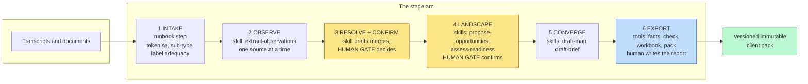
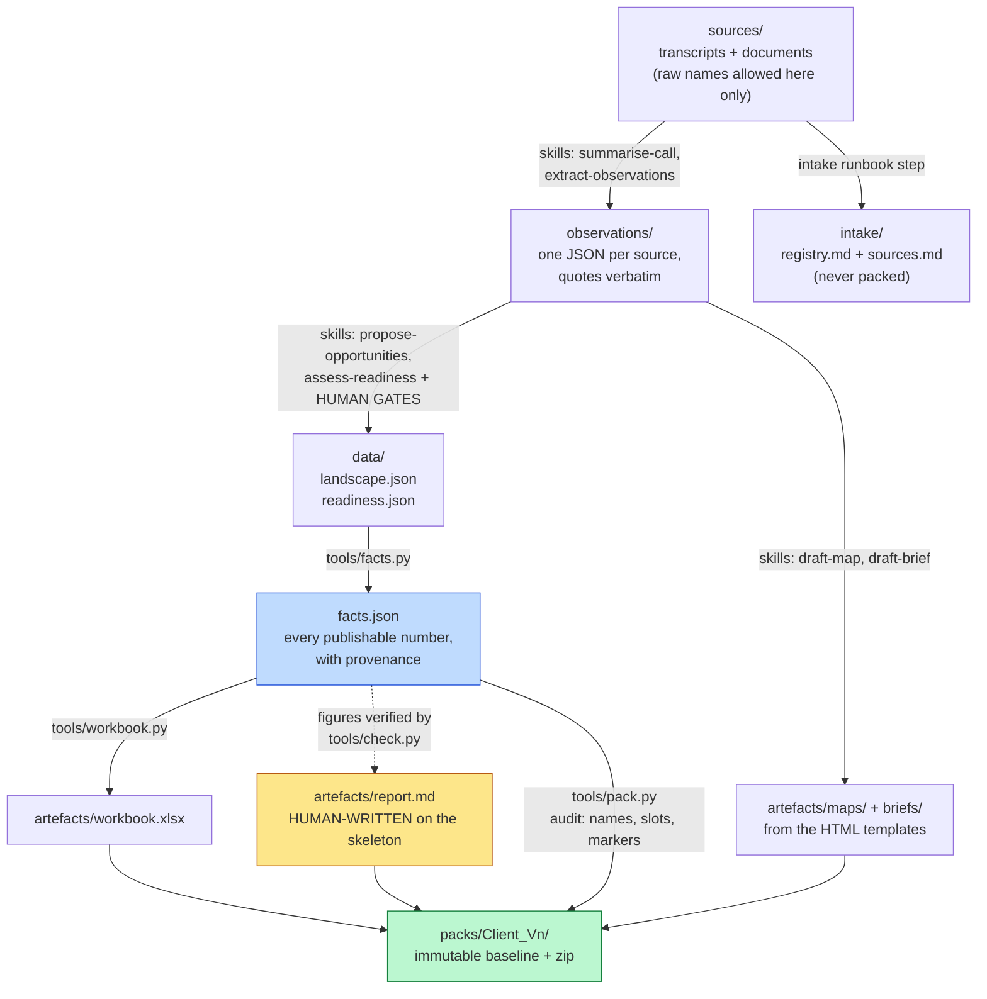

# Architecture

## What this is, in one sentence

A consulting method written down as a repository: markdown playbooks and skill prompts
that Claude runs in a session, four small deterministic Python tools that produce every
number, and static templates that become the client's deliverables.

It is not an application. There is no server, no database, no build system and no user
interface, and that was decided on purpose (the PRD rules a hosted service or UI out of
scope for v0.1).

## Who does what

Claude drafts from the skills, the Python tools check what it drafts, and a person
decides. Each part of the repo does one of those three jobs.

| Layer | What it is | Runs on |
|---|---|---|
| Method (`method/`, `taxonomy/`) | The playbook. It covers the engagement arc, the session kit, the 20-area instrument, the frameworks for sequencing work, and the controlled vocabulary | A person reads it, and Claude loads it as context |
| Skills (`skills/`) | Six markdown prompt files for the work that needs judgement (summarising, extracting, drafting), each carrying the evidence rules inline | Claude, in a Claude Code session, one source or artefact at a time, with a person confirming after every stage |
| Tools (`tools/`) | Four Python scripts, `facts.py`, `check.py`, `workbook.py` and `pack.py`. Every count, join, verification and export is done by deterministic code, never by a model | Python 3, the standard library plus `openpyxl`, on the command line only |
| Templates (`templates/`) | The report skeleton (markdown with slots and publishing directives), the map and brief HTML, five diagram HTML files, the workbook spec, and the pack README and CLAUDE.md | Filled by skills and tools. The HTML opens in any browser without a server |
| Fixture (`fixtures/caldergate/`) | One engagement, invented throughout, that exercises every module and is committed with its complete worked run | The regression surface for every change |

Two hard limits are part of the design. There are four tools and no more, because a tool
that needs a tree of subcommands is doing a skill's job. A skill must be editable in one
sitting, because if changing a prompt means changing code, the stage has been split in
the wrong place. Both limits exist because the earlier pipeline kept growing machinery
until it was hard to change. Its computed report was eventually replaced wholesale by a
hand-written one, and nobody missed it.

## The stage arc

Work moves through six stages, and each boundary between them was shown to be worth
having on a delivered engagement. The stages that need judgement are skills, and the
deterministic stages at the end are tools. Amber marks the points where a person has to
confirm.

`method/stage-arc.md` gives the reasoning for each stage. It covers what the reference
implementation got right, what made it hard to change, and why each stage is a skill or
a script here.

## The engagement workspace and its data contracts

Each engagement runs in its own folder outside this repo, laid out as
`docs/workspace-layout.md` describes. The contracts between stages are plain JSON. There
is `engagement.json` (config, names list, verified evidence figures), one observations
file per source (claims with verbatim quotes and locators), `landscape.json` and
`readiness.json` (the confirmed data), and `facts.json`, the generated manifest that
every artefact reads its numbers from.

The same identity and consistency rules apply across all of these contracts. Every
entity has a stable ID, and joins use IDs rather than display names, so renaming
something is one edit. There is a single controlled vocabulary file. Derived counts,
such as memberships, waiting counts and roll-ups, are always recomputed and never
stored. A blank cell is a gap in the data, which is counted and reported, and never an
error.

## The four tools

| Tool | Owns | Refuses |
|---|---|---|
| `facts.py` | Deriving every publishable count and figure from the confirmed data, with provenance; referential integrity on the landscape; the 20-area shape on readiness | Broken joins (build failure, not a warning) |
| `check.py` | The prose lint (config-driven ban list with poison/clean self-test fixtures, style budgets, directive names), figure traceability against `facts.json`, page-end layout checks on rendered PDFs | Grading anything before every rule proves it can both fire and stay silent |
| `workbook.py` | Building the xlsx from the landscape, six-questions arrangement, stable-ID joins | Hand edits (it rebuilds; names are not identifiers) |
| `pack.py` | The versioned deliverable folder and zip; README and CLAUDE.md filled from templates and facts; the stray-name, unfilled-slot and draft-marker audit | Overwriting an existing baseline, ever |

The checker's self-test is the main reason to trust the repo. An earlier checker passed
for weeks while testing nothing. So every rule here carries a poison fixture that it
must flag and a clean fixture that it must not, and grading will not run until every
rule has passed both.

## Privacy model

Privacy is protected at more than one layer, as decision 0002 sets out. At intake,
people are replaced by role tokens. The tokens are seeded from each source's
participants frontmatter, and a name is replaced wherever it is spoken or used to
address someone. Prospect and customer companies are always tokenised. At export,
everything is audited anyway, through the checker's names list and the pack audit. The
registry that maps names to tokens never leaves the engagement workspace, and
tokenisation never matches numbers. Live client workspaces never enter this repo. The
synthetic fixture is the only engagement committed here.

## Branding model

The kit is neutral (decision 0001). Every surface that could carry a brand is a token,
whether that is a CSS variable in the HTML templates and diagrams, the slot for a
register exemplar in the judgement rubric, or an identity slot that `pack.py` fills. A
skin supplies all of these without touching kit files (`skins/README.md`). If applying a
skin means editing the taxonomy, method, skills or tools, the kit has a defect.

## Dependencies and runtime

- Python 3 (standard library) plus `openpyxl` for the workbook. Nothing else.
- Claude Code, or any Claude session with file access, as the runtime for the skills.
- Git and GitHub. CI (`.github/workflows/ci.yml`) runs `demo.sh` and compares the
  regenerated `facts.json` with the committed one. `requirements.txt` pins `openpyxl`.
- The HTML deliverables are self-contained files that use a system font stack and make
  no external requests, so they open from disk without a server.

## Lineage and the decision log

The processing arc and the evidence rules were first proven in an earlier, heavier
pipeline that the author built and ran on a real engagement. This kit is the lean
rebuild, and where it disagrees with that pipeline, the kit wins. Standing choices are
recorded in `docs/decisions/`, covering positioning, the names policy, the four-tool
limit and intake as a runbook step, the licence, and the public release. Every
deliberate divergence gets its own decision file, so nothing drifts without a record.
