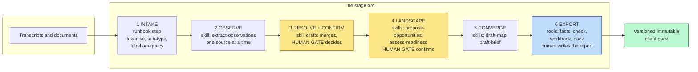
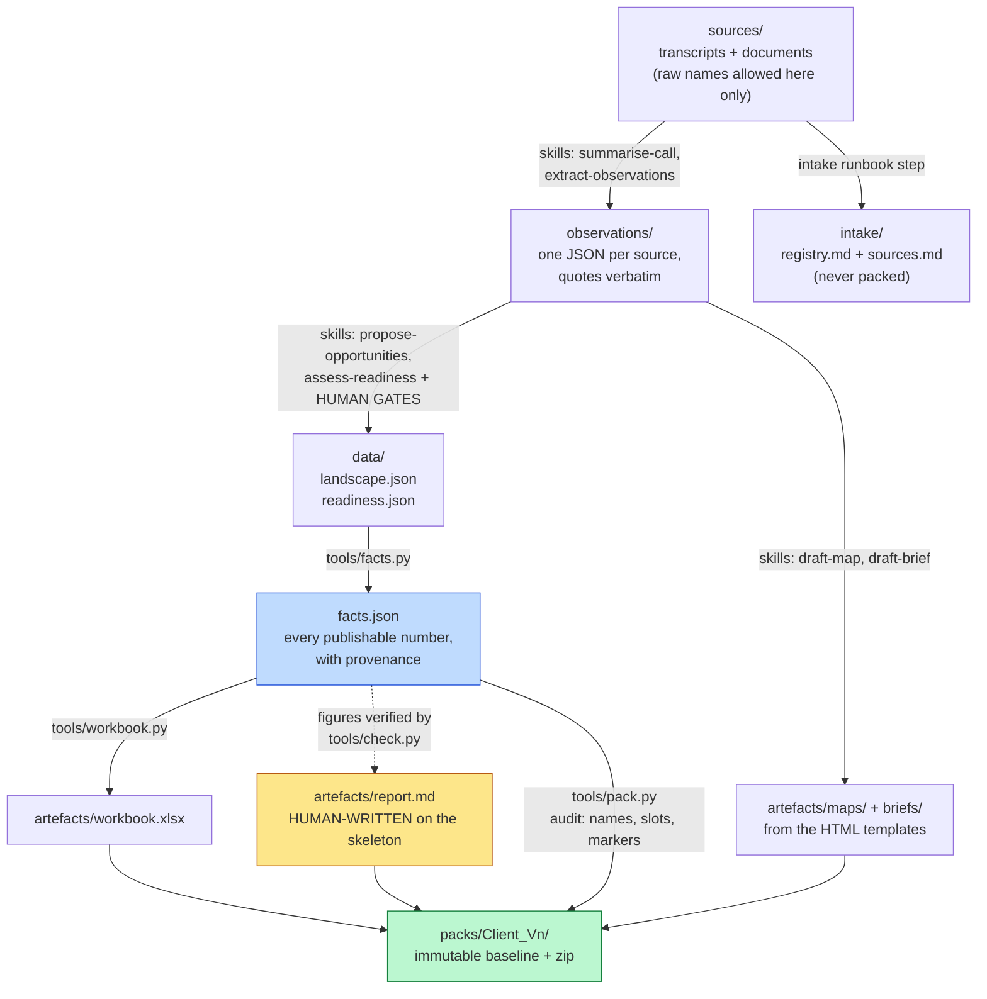

# Architecture

## What this is, in one sentence

A consulting methodology codified as a repository: markdown playbooks and skill
prompts that Claude executes in a session, four small deterministic Python tools that
own every number, and static templates that become the client deliverables. It is not
an application: there is no server, no database, no build system and no user
interface, by decision (the PRD rules a hosted service or UI out of scope for v0.1).

## The division of labour

**Skills draft, tools check, the human decides.** Everything in the repo sits on one
side of that line:

| Layer | What it is | Runs on |
|---|---|---|
| Method (`method/`, `taxonomy/`) | The playbook: engagement arc, session kit, the 20-area instrument, sequencing frameworks, controlled vocabulary | A person reads it; Claude loads it as context |
| Skills (`skills/`) | Six markdown prompt files for the judgement work (summarising, extracting, drafting), each carrying the evidence rules inline | Claude, in a Claude Code session, one source or artefact at a time, with a human confirm gate after every stage |
| Tools (`tools/`) | Four Python scripts: `facts.py`, `check.py`, `workbook.py`, `pack.py`. Every count, join, verification and export is deterministic code, never model output | Python 3, standard library plus `openpyxl`; command line only |
| Templates (`templates/`) | The report skeleton (markdown with slots and publishing directives), map and brief HTML, five diagram HTML files, workbook spec, pack README and CLAUDE.md | Filled by skills and tools; the HTML opens in any browser, no server |
| Fixture (`fixtures/caldergate/`) | One fully synthetic engagement exercising every module, committed with its complete worked run | The regression surface for every change |

The hard caps are design guardrails, not conventions: four tools, no more (a tool
needing a subcommand tree is doing the skills' job), and a skill must be editable in
one sitting (if changing a prompt means changing code, the stage is wrong). They
exist because the predecessor pipeline grew machinery until it was hard to change,
and its computed report was replaced wholesale by a hand-written one that nobody
missed.

## The stage arc

Work flows through six stages; the boundaries each earned their place in a delivered
engagement. Judgement stages are skills; the deterministic tail is tools; amber marks
the human gates.

The rationale per stage (what the reference implementation got right, what made it
hard to change, and why each stage is a skill or a script here) is in
`method/stage-arc.md`.

## The engagement workspace and its data contracts

Every engagement runs in its own folder outside this repo, defined in
`docs/workspace-layout.md`. The contracts are plain JSON: `engagement.json` (config,
names list, verified evidence figures), one observations file per source (claims with
verbatim quotes and locators), `landscape.json` and `readiness.json` (the confirmed
data), and `facts.json`, the generated manifest every artefact reads its numbers
from.

Identity and consistency rules enforced across the contracts: every entity carries a
stable ID and joins use IDs, never display names (a rename is one edit); one
controlled vocabulary file; derived counts (memberships, waiting counts, roll-ups)
are always recomputed, never stored; blank cells are recorded gaps in the data,
counted and reported, never errors.

## The four tools

| Tool | Owns | Refuses |
|---|---|---|
| `facts.py` | Deriving every publishable count and figure from the confirmed data, with provenance; referential integrity on the landscape; the 20-area shape on readiness | Broken joins (build failure, not a warning) |
| `check.py` | The prose lint (config-driven ban list with poison/clean self-test fixtures, style budgets, directive names), figure traceability against `facts.json`, page-end layout checks on rendered PDFs | Grading anything before every rule proves it can both fire and stay silent |
| `workbook.py` | Building the xlsx from the landscape, six-questions arrangement, stable-ID joins | Hand edits (it rebuilds; names are not identifiers) |
| `pack.py` | The versioned deliverable folder and zip; README and CLAUDE.md filled from templates and facts; the stray-name, unfilled-slot and draft-marker audit | Overwriting an existing baseline, ever |

The checker's self-test convention is the repo's trust mechanism: a predecessor
checker passed for weeks while testing nothing, so every rule here carries a poison
fixture it must flag and a clean fixture it must not, and grading refuses to run
until all prove out.

## Privacy model

Defence in depth, decided as decision 0002: people become role tokens at intake
(seeded from each source's participants frontmatter, swept through speech and
vocatives), prospect and customer companies are tokenised always, and the export
side audits everything anyway (the checker's names list, the pack audit). The
name-to-token registry never leaves the engagement workspace. Tokenisation never
matches numerics. Live client workspaces never enter this repo; the synthetic
fixture is the only committed engagement.

## Branding model

The kit is neutral (decision 0001). Every brandable surface is a token: CSS
variables in the HTML templates and diagrams, a register exemplar slot in the
judgement rubric, identity slots filled by `pack.py`. A skin supplies those without
touching kit files (`skins/README.md`); if applying a skin requires editing
taxonomy, method, skills or tools, that is a kit defect.

## Dependencies and runtime

- Python 3 (standard library) plus `openpyxl` for the workbook. Nothing else.
- Claude Code (or any Claude session with file access) as the skills' runtime.
- Git and GitHub. CI (`.github/workflows/ci.yml`) runs `demo.sh` and diffs the
  regenerated `facts.json` against the committed one. `requirements.txt` pins
  `openpyxl`.
- The HTML deliverables are self-contained files using a system font stack and no
  external requests; they open from disk, no server.

## Lineage and the decision log

The processing arc and evidence rules were proven in an earlier, heavier pipeline the
author built and ran on a real engagement; this kit is the lean rebuild. Where the
kit disagrees with that pipeline, the kit wins. Standing choices
live in `docs/decisions/` (positioning, names policy, the four-tool cap and intake
as a runbook step, licence, public release). Every deliberate divergence gets a decision
file, not a silent drift.
